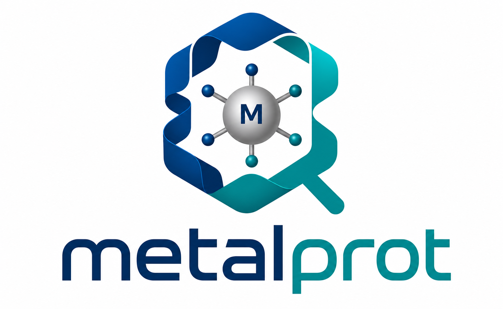

<p align="center">
  
</p>

# METALPROT

METALPROT searches for metal-binding sites in protein backbones using Metal Mers: local coordination motifs that connect backbone geometry, coordinating side chains, and metal positions. The search combines backbone alignment, compatibility graphs, and geometric scoring.

If using this work please cite:

> De novo design of metalloenzymes using Metal Mer. C. Shan, Z. Ren, J. Yu, Y. Gao, C. Wu, X. Zhong, L. Lu. bioRxiv 2026.10.13.758590; doi: [https://doi.org/10.64898/2026.10.13.758590](https://doi.org/10.64898/2026.10.13.758590)

## Repository Layout

```text
metalprot/     Core representations, database tools, search, and scoring
examples/      Runnable examples with inputs, settings, and reference results
scripts/       Search, result comparison, and database verification entry points
data/pdb_ids/  Source PDB ID lists for the curated Zn and Fe libraries
assets/        Project logo
docs/          Usage, methods, and data documentation
tests/         Release regression tests and required fixtures
```

## Dependencies

The supported environment uses Python 3.9.22 and ProDy 2.4.1 with NumPy 1.23.5. Additional scientific dependencies are pinned in `requirements.txt`. Automated checks run on Ubuntu 22.04. The basic example runs on a CPU and does not require a GPU.

## Installation

```bash
git clone --depth 1 --branch main --single-branch https://github.com/Mituan02/Metalprot.git
cd Metalprot
conda env create -n metalprot -f environment.yml
conda activate metalprot
python -m pip install --no-deps --no-build-isolation .
```

## Running an Example

**Prepare a local Metal Mer database before running a search.** Set `database` in `examples/basic_search/config.json` to a directory containing `AAMetalPhiPsi.pkl`, `all_metal_vdm.pkl`, and `cluster_centroid_dict.pkl` from the same library. Relative input paths are resolved from the configuration file's directory.

Run the three-histidine zinc-site example based on PDB 5OD1:

```bash
bash examples/basic_search/run.sh
```

The script validates the inputs, runs the search, and compares the current results with the reference. With the original Zn library and settings, it retains four representative designs. Outputs include candidate PDB structures, a score summary in TSV format, and a `run_manifest.json` record. An interactive version is available in `examples/basic_search/demo.ipynb`.

For your own structure, update `target`, `positions` (PDB chain identifiers and residue numbers), the database, and filters in the configuration, then run:

```bash
python scripts/run_search.py --config examples/basic_search/config.json --check-only
python scripts/run_search.py --config examples/basic_search/config.json --outdir outputs/custom_search
```

Use `python scripts/run_search.py --help` for command-line options. The bundled 5OD1 example validates the software workflow; it is not the paper's 2CBA reconstruction or a complete metalloenzyme design pipeline.

## Data

Metal Mer databases contain coordination motifs for metals including **Zn, Fe, Co, Mn, and Cu**. Database files are managed separately and are not included in the current source snapshot. A processed database is required to run the search.

Source structures represented in the current curated libraries are listed below, with one unique PDB ID per line:

- **Zn:** [1,366 PDB IDs](data/pdb_ids/zn_pdb_ids.txt)
- **Fe:** [223 PDB IDs](data/pdb_ids/fe_pdb_ids.txt)

These lists describe the final libraries, not the full sets initially downloaded for database construction. The Fe list comes from the Fe-only library.

## Authors

The software was developed by Lei Lu and Zhuoyun Ren. This repository is based on [lonelu/Metalprot](https://github.com/lonelu/Metalprot).

## License

The code is available under the MIT License.
